# 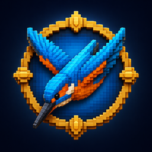 Ciel Cobalt

> Un shoot'em up roguelite en voxels où tout se casse : barrage, pont, volcan, porte-avions. Spécifié, arbitré et testé par moi, codé par des agents IA, jouable dans le navigateur.

**[🎮 Jouer dans le navigateur](https://goethals.fr/ciel-cobalt/) · Steam : page en préparation · [🌐 Portfolio](https://goethals.fr/)**

  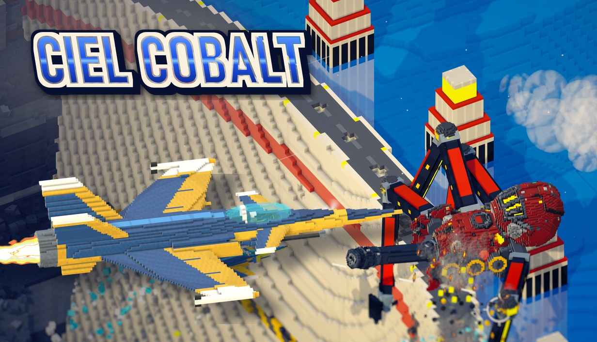

---

  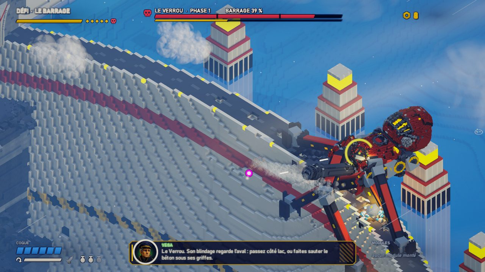
  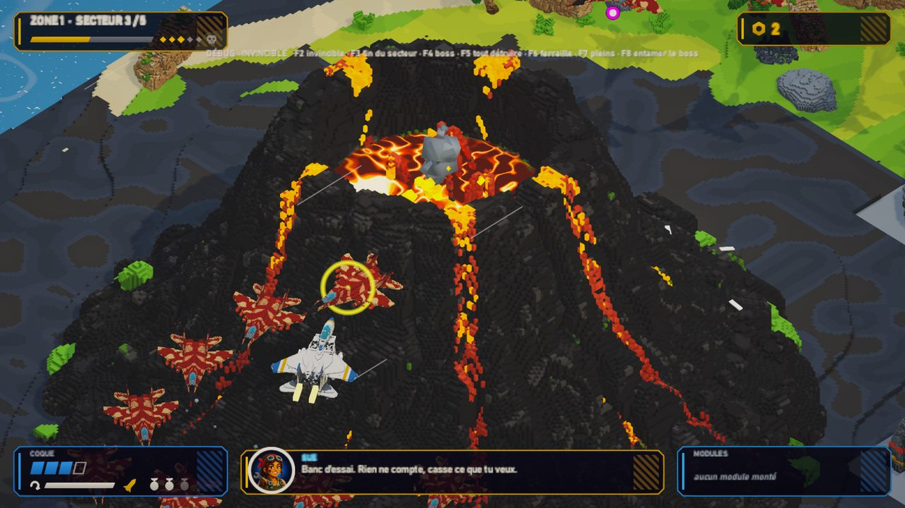
  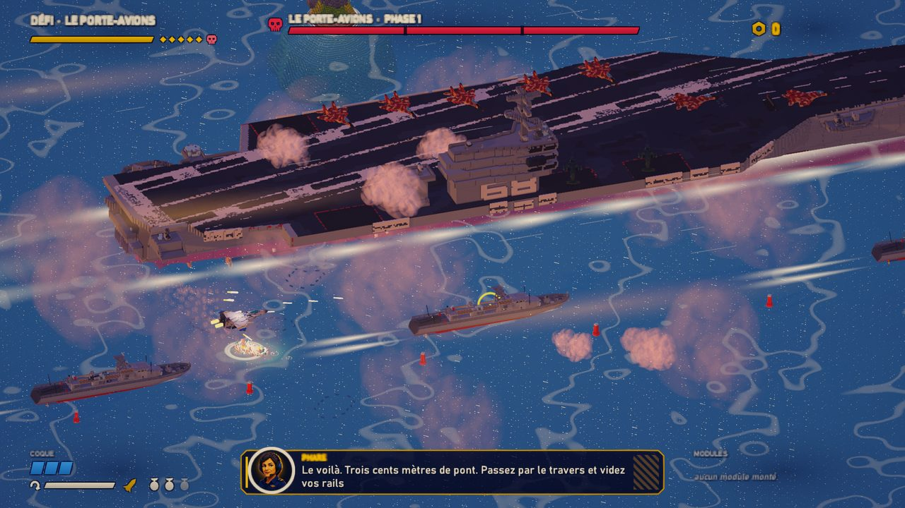

  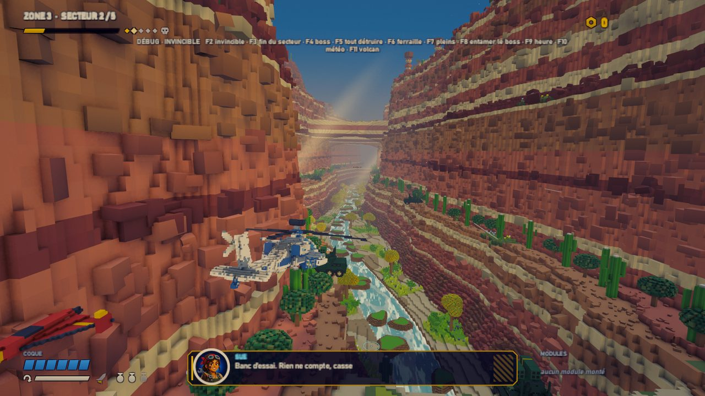
  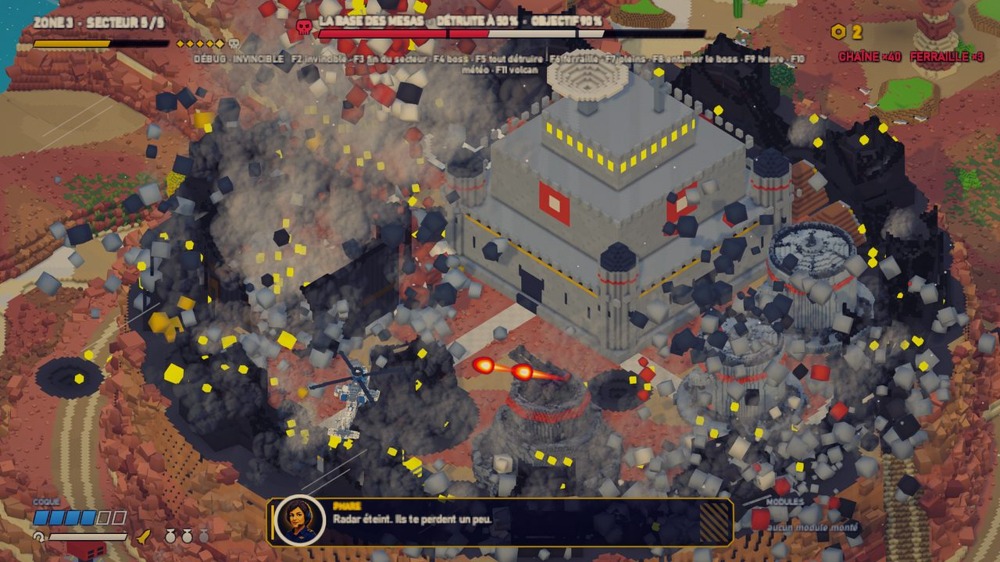
  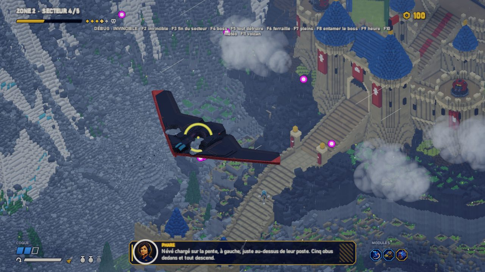

  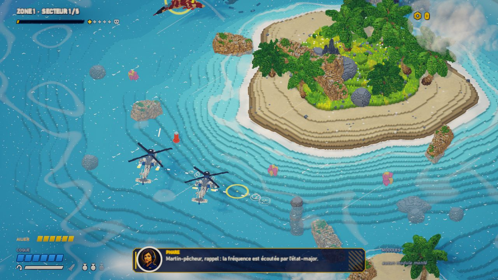
  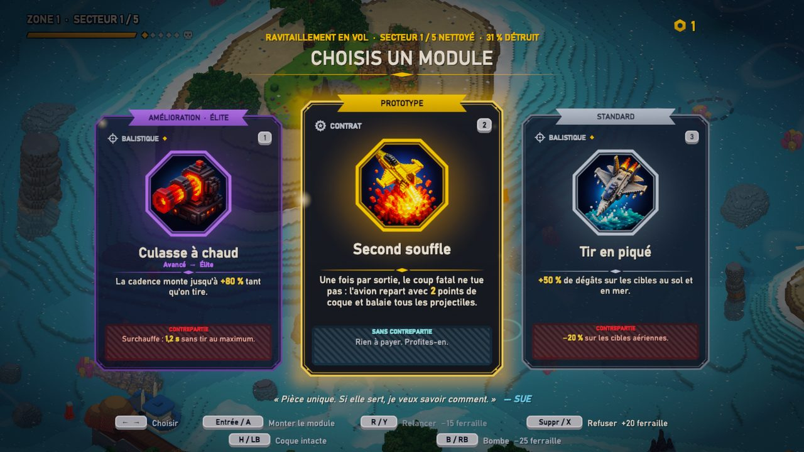
  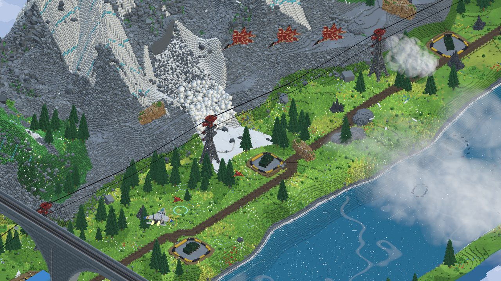

---

## 📚 Documentation détaillée

- **[01 - Vision et cadrage produit](./docs/01-vision-et-produit.md)** - Promesse, piliers, boucle de jeu, jalons à critère de fin, journal de 39 décisions
- **[02 - Piloter des agents IA](./docs/02-piloter-des-agents-ia.md)** - Règles écrites pour les agents, références d'abord, preuve par capture, plusieurs sessions en parallèle
- **[03 - Technique](./docs/03-technique.md)** - Chaîne d'assets voxel, destruction, génération par graine, eau sur la carte graphique, 150 tests au pilote automatique
- **[04 - Mise sur le marché](./docs/04-mise-sur-le-marche.md)** - Étude de quinze pages Steam d'indés, prix, calendrier, déclaration d'IA, version web

---

## C'est quoi

Ciel Cobalt est un shoot'em up twin-stick en vue isométrique. Un stick pilote, l'autre vise, en l'air comme au sol. Le monde est une maquette en voxels à l'échelle réelle et tout ce qui est touché se découpe bloc par bloc : un pont qui tombe emporte le convoi qui le traversait, une forêt prend feu et l'incendie gagne de proche en proche, une bombe creuse la colline jusqu'à la mer et le trou se remplit d'eau.

Une sortie traverse quatre pays (l'Archipel, les Hautes-Terres, les Terres rouges, le Grand Port), vingt secteurs générés à chaque départ, trois boss : un sous-marin de 110 mètres, un barrage de 108 mètres et son gardien, un porte-avions. À chaque escale, on choisit un module parmi trois, et aucun ne se contente d'ajouter des dégâts : obus incendiaires, laser qui tranche un immeuble à la base, drone ailier, mine larguée pendant le tonneau.

**Le récit.** Une usine détraquée, le Fondeur, réimprime sa flotte en blocs chaque nuit : c'est la raison pour laquelle le monde est en voxels et change à chaque sortie. La capitaine Roxane « Roxy » Vasseur, indicatif Martin-pêcheur, lui casse tout chaque matin. La machine s'est entichée d'elle et lui fait la cour en fabriquant : un volcan pour l'ambiance, un château pour la princesse, un porte-avions pour qu'elle se pose chez lui. Les répliques radio sont doublées en français et en anglais.

**Deux appareils, seul ou à deux :** le Martin-pêcheur, un chasseur rapide, et le Bourdon, un hélicoptère lent et lourdement armé. Chacun gagne son expérience et ses niveaux. À deux sur le même écran, l'ailier abattu revient au bout de dix secondes tant que l'autre vole.

---

## Mon rôle : Product Owner d'une équipe d'agents IA

Je n'ai pas écrit le code à la main. J'ai tenu le rôle de Product Owner et de directeur artistique, et des agents IA (Claude Code, Codex) ont écrit le code, les outils et les tests. Mon travail a été de rendre leur production juste :

- **Cadrer** : un GDD d'une page avec cinq piliers, une boucle de jeu, un index des fonctionnalités avec leur statut, des jalons qui disent quand ils sont atteints.
- **Décider et tracer** : 39 décisions datées, chacune avec les alternatives écartées et la raison. Quand un retour de partie contredit une décision, elle est révisée et le journal le dit.
- **Écrire les règles du projet pour les agents** : « voir grand » avec des tailles chiffrées, une planche de référence avant tout décor, aucune sortie au hasard non seedée, preuve par capture au cadrage du jeu.
- **Juger sur pièces** : chaque lot revient avec une capture avant / après posée à côté de sa référence. Je refuse ce qui ne tient pas la comparaison.
- **Faire tourner plusieurs agents à la fois** sur le même dépôt, avec une discipline de commit qui évite qu'ils s'écrasent.

  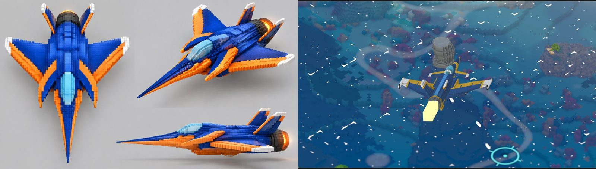
   La méthode en une image : la planche de référence d'abord (à gauche), puis le modèle dans le jeu, jugé à côté d'elle (à droite)

---

## Ce que ça démontre

| Compétence | Ce qui le prouve |
|---|---|
| Vision produit | Une promesse en une phrase (« une maquette qu'on a le droit de casser »), cinq piliers qui disent aussi ce qu'on refuse, un récit qui justifie la boucle de jeu |
| Product Ownership | GDD tenu à jour, index des fonctionnalités par statut, jalons M0 à M5 avec critère de fin, 39 décisions tracées avec alternatives et raisons |
| Arbitrage par la donnée | Durée d'une sortie mesurée par un pilote automatique (30,8 min sur trois pays) plutôt qu'estimée ; altitude de vol recalculée en pourcentage de l'écran après la première partie jouée |
| Pilotage d'agents IA | Règles du projet écrites pour les agents (`CLAUDE.md`, `AGENTS.md`), mémoire des retours, plusieurs sessions en parallèle, commits ligne à ligne |
| Direction artistique | Planche de référence obligatoire avant chaque décor, comparaison avant / après, palette et couleurs réservées (magenta pour les tirs ennemis, interdit ailleurs) |
| Ingénierie de jeu | Moteur voxel maison sur Unity 6 (maillage glouton, destruction par morceaux, débris instanciés), génération procédurale seedée, eau simulée en compute shader avec repli WebGL |
| Qualité | 150 tests dans 63 fichiers, la plupart joués en vrai par un pilote automatique ; Unity piloté sans interface pour compiler, jouer et capturer |
| IA générative maîtrisée | Modèles 3D (Tripo3D) convertis en voxels par une chaîne Python, musiques (Suno), voix (synthèse vocale), portraits : tout choisi, corrigé et intégré à la main, rien de généré pendant la partie |
| Mise sur le marché | Étude de quinze pages Steam d'indés qui ont marché, prix relevé chez les concurrents directs, calendrier aligné sur les festivals de Steam, version web en ligne |

---

## En chiffres

- **144 commits** du 16 au 22 novembre 2026 : du premier modèle voxel à une version jouable en ligne en une semaine
- **~77 000 lignes** de C# dans 193 fichiers, plus une chaîne d'outils Python (voxélisation, interface, audio, captures)
- **150 tests** dans 63 fichiers, dont 142 joués dans le moteur
- **27 documents de conception**, environ 117 000 mots : GDD, bible des assets, génération, roguelite, combat, technique, UX, scénario, distribution, recherches
- **39 décisions** tracées, **5 piliers**, **6 jalons**
- **4 pays, 20 secteurs, 3 boss**, 2 appareils, coopération à deux
- **61 musiques**, **246 bruitages**, **189 répliques** doublées en français et en anglais

---

## Stack

**Jeu :** Unity 6 (6000.6), URP 17 Forward+, C#, tout construit par code (la scène ne contient qu'un objet de démarrage), Input System (clavier, souris, manette)

**Rendu :** un seul matériau URP Lit pour tout le jeu, couleur et occlusion lues dans un atlas de palette 1024 × 4 ; eau simulée en compute shader sur la carte graphique, repli en cubes quand la carte ne suit pas (WebGL 2)

**Outils :** chaîne Python `VoxelForge` (maillage 3D texturé → voxels à taille réelle → format compact `VXG2`), rendu de décors sans Unity, générateurs d'interface et d'icônes, construction WebGL et bureau en ligne de commande

**Contenu :** Tripo3D pour certains décors et boss, Suno pour les musiques, synthèse vocale pour les voix, GPT Image pour portraits et illustrations ; modèles Sketchfab sous licence et kits CC0 (Kenney, Quaternius), passés par la même chaîne de voxélisation

**Agents :** Claude Code et Codex, guidés par les règles du projet et une mémoire des retours

---

## Liens

- Jouer dans le navigateur : [goethals.fr/ciel-cobalt](https://goethals.fr/ciel-cobalt/) (ordinateur, clavier et souris ou manette)
- Autres projets : [github.com/GtAntoine](https://github.com/GtAntoine) · [goethals.fr](https://goethals.fr/)

Le code source du jeu reste privé ; ce dépôt présente le produit, la méthode et les choix.
