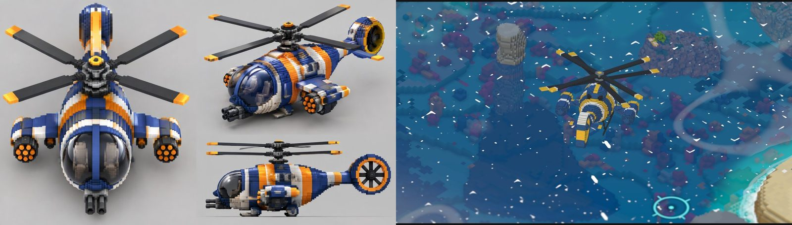

# 02 - Piloter des agents IA

[← Retour au sommaire](../README.md)

Ciel Cobalt est né d'une question : jusqu'où peut aller une seule personne qui tient le rôle de Product Owner et de directeur artistique, avec des agents IA comme équipe de développement ? En une semaine, 144 commits, environ 77 000 lignes de C#, 150 tests et 27 documents de conception. Le code est écrit par les agents (Claude Code, Codex). Ce document décrit ce que j'ai fait, moi, pour que ce code soit le bon.

## 1. Écrire les règles du projet pour les agents

Un agent repart de zéro à chaque session. Ce qu'il doit savoir est donc écrit à la racine du dépôt, dans `CLAUDE.md` et `AGENTS.md`, et relu à chaque démarrage. Ces règles viennent toutes d'un retour réel : elles sont ajoutées le jour où un problème se répète.

**Règle n°1 : voir grand, exagérer, être ambitieux.** Après plusieurs lots où les ouvrages arrivaient « juste assez grands pour être vus », la règle a été chiffrée, parce qu'une consigne vague ne change rien au comportement d'un agent :

- dimensionner chaque ouvrage par rapport à l'écran visible (environ 78 m de haut) ;
- moins de 15 % de la hauteur d'écran, c'est un détail, pas une vedette ;
- se mesurer aux plus grands modèles du jeu avant de montrer quoi que ce soit : hangar 41 m, tour radar 30 m, donjon du fort 36 m, barrage de 108 m.

**Les autres règles**, chacune issue d'un incident :

| Règle | D'où elle vient |
|---|---|
| Une planche de référence avant tout décor ou objet nouveau ; sans planche, ne pas commencer | des décors inventés « à l'échelle de l'écran » qui manquaient de crédibilité |
| Aucun tirage au hasard non seedé dans les effets, la décoration ou le placement | un tirage en trop décalait tous les événements suivants d'une sortie, et a révélé un plantage |
| Un objet posé a une raison d'être là (accès, lien avec ce qui l'entoure) | des objets isolés, posés pour remplir |
| Pas de tache de couleur vive sur ce qui devrait être rouillé ; un seul niveau de détail pour ce qui est visible ensemble | un remorqueur de kit « jouet » qui jurait à côté d'une vedette détaillée |
| Pas d'appareil réel : escadrille dessinée pour le jeu, noms d'animaux inventés | un choix de propriété intellectuelle avant la page Steam |
| Vérifier sur une capture au cadrage du jeu | des modèles jugés beaux en vue isolée, illisibles une fois en jeu |
| Ne pas lancer Unity ni toucher aux scripts pendant que je joue | le jeu se teste dans mon éditeur, en même temps que les agents travaillent |

## 2. Références d'abord, preuve par l'image

Aucun décor ne se fait de mémoire. L'agent produit ou retrouve d'abord une planche (image générée dans Tripo, recherche sur l'ouvrage réel, mesures), je la valide, puis il construit. À la livraison, la capture du jeu est posée à côté de la planche, au cadrage réel du jeu.

  
   Le Bourdon : la planche validée, puis le modèle en jeu, jugé à côté

Cette règle change la nature de la revue. Je ne lis pas le code : je compare deux images. C'est rapide, objectif, et c'est là que les écarts se voient (proportions, couleurs, lisibilité à la taille réelle). Les grands ouvrages partent en plus d'un ouvrage réel mesuré, noté dans un document de recherche : le barrage du jeu est passé de 22 m à 108 m après cette comparaison.

## 3. Une mémoire des retours

Mes retours ne doivent pas être répétés deux fois. Chaque retour qui vaut au-delà de la tâche du jour est noté dans une mémoire que les agents relisent : goût musical (tempo, style, ce qui a été refusé et pourquoi), direction artistique, rythme des niveaux (pas d'ennemis en paquet dès l'entrée d'un secteur), nom du jeu (l'ancien nom de travail est banni du code, des chemins et des documents). Une préférence devient ainsi une règle stable.

## 4. Plusieurs agents en parallèle sur le même dépôt

Sur la fin, plusieurs sessions d'agents travaillaient en même temps dans le même dossier : l'une sur la simulation de l'eau, une autre sur les incendies de forêt et les arbres qui écrasent, une troisième sur la faune qui réagit aux tirs (poissons, mouettes, canards). Pour que ça tienne, des règles de commit écrites pour eux :

- chacun ne commite que ses propres lignes : fichier par fichier, et dans un fichier partagé, seulement ses morceaux ;
- jamais d'ajout global (`git add -A`) ;
- avant de toucher un fichier qu'une autre session modifie, la prévenir ;
- vérifier que ce qu'on commite compile seul, à partir de l'état publié ;
- tout va directement sur la branche principale, en petits commits qui disent pourquoi.

La mise en ligne a sa propre règle : la version web se construit depuis la branche publiée, dans une copie propre, jamais dans le dossier de travail qui porte le travail non commité des autres. On dit toujours de quel commit elle vient.

## 5. Des tests que l'on peut lire comme des critères d'acceptation

Les tests ne vérifient pas seulement le code, ils vérifient le jeu. La plupart se jouent dans le moteur, avec un pilote automatique :

- `FairnessTest.AWholeSortieLastsHalfAnHour` fait voler la sortie entière, une fois par appareil, et mesure sa durée ;
- d'autres vérifient qu'un barrage cède, qu'un pont emporte son convoi, qu'une avalanche dévale, que la coopération ramène l'ailier abattu, que l'eau retombe en neuf secondes ;
- chaque test d'effet prend sa capture, ce qui donne la preuve visuelle en même temps que le verdict.

Unity est piloté sans interface (compiler, jouer, capturer en ligne de commande), et un outil Python dessine un décor sans lancer Unity du tout. Les agents vérifient donc leur travail seuls, sans attendre que j'ouvre l'éditeur, et je reçois des captures, pas des promesses.

## 6. Ce que j'en retiens

- **Un agent suit des règles chiffrées, pas des intentions.** « Fais grand » ne change rien ; « une vedette occupe plus de 15 % de l'écran » change tout.
- **La revue par comparaison d'images passe à l'échelle.** Je juge cinq lots en parallèle en regardant des avant / après, pas des diffs.
- **Le journal de décisions évite de refaire les mêmes essais.** Un agent qui arrive lit pourquoi une option a été écartée.
- **La vitesse a un coût de coordination.** Plusieurs agents sur un dépôt demandent une discipline de commit stricte ; une fois écrite, elle tient.

[← Précédent : 01 - Vision et cadrage produit](./01-vision-et-produit.md) · [Suivant : 03 - Technique →](./03-technique.md)
