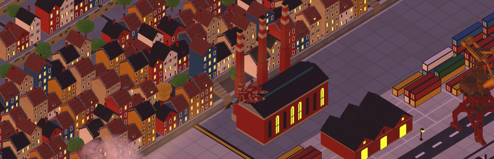

# 04 - Mise sur le marché

[← Retour au sommaire](../README.md)

Un jeu fini qui ne se vend pas est un prototype. La sortie sur Steam a donc été préparée comme une partie du produit, en parallèle du développement, avec la même règle que pour le reste : partir de ce qui a marché, et le mesurer.

## Étudier quinze indés qui ont marché

Avant d'écrire une ligne de la page Steam, quinze fiches d'indés proches ont été relevées et comparées : Brotato, Vampire Survivors, Minishoot' Adventures, Tiny Glade, Sky Force Reloaded, Enter the Gungeon, Hades, Sky Rogue, Teardown, Nova Drift, Balatro, entre autres. Pour chacune : prix, avis, description courte, captures, et la durée de la bande-annonce principale avec ses cinq premières secondes regardées image par image.

Ce qui en est sorti, et appliqué :

| Constat | Appliqué à Ciel Cobalt |
|---|---|
| Les meilleures descriptions courtes donnent le genre exact dans les dix premiers mots, puis des verbes concrets | « Shoot'em up roguelite twin-stick où tout se casse. Faites sauter un barrage, effondrez un pont sous un convoi, réveillez un volcan et coulez un porte-avions… » |
| Le jeu apparaît dès la première image de la bande-annonce ; les logos de studio coûtent des spectateurs | bande-annonce qui ouvre sur une destruction |
| La médiane des bandes-annonces de lancement est autour de 80 s | durée visée en conséquence |
| Les cinq premières étiquettes décident des « jeux similaires » | Shoot 'Em Up · Tir à deux joysticks · Action et roguelike · Destruction · Voxel, jamais « Indépendant » dans les cinq |
| Teardown et Tiny Glade ont décollé sur des clips courts partagés | un clip de destruction de 6 à 10 s par semaine sur les réseaux |

## Prix

**14,99 €**, avec 10 % de remise de lancement pendant sept jours. Relevé sur Steam (France) en novembre 2026 : les shoot'em up et roguelites indés qui se vendent sont entre 12 et 17 € (Minishoot' 14,99 €, Tiny Glade 14,79 €, Enter the Gungeon 14,79 €, Balatro 13,99 €, Nova Drift 16,99 €) ; au-delà de 20 €, le public ne suit pas. Ce prix laisse de la place pour des soldes à −20 ou −30 % sans descendre sous 10 €.

## Calendrier aligné sur Steam

La sortie en décembre 2026, envisagée au départ, a été écartée : la vérification d'identité de Valve n'était pas faite, et la fin décembre tombe dans les soldes d'hiver, où une sortie se voit peu. Le calendrier recommandé suit ce que font les indés qui réussissent :

| Quand | Quoi | Pourquoi |
|---|---|---|
| Dès l'App ID | Page « Prochainement » | chaque semaine en ligne amasse des listes de souhaits |
| Chaque semaine | Un clip de destruction de 6 à 10 s | la destruction se partage d'elle-même |
| Février 2027 | Festival Steam du jeu coopératif sur un écran | le jeu a la coopération locale |
| Printemps 2027 | Démo publique (un pays jusqu'à son boss) | une part importante des joueurs d'une démo ajoute le jeu à sa liste |
| Juin 2027 | Steam Next Fest | une seule participation par jeu : y entrer avec au moins 2 000 listes |
| Septembre 2027 | Sortie | hors soldes d'été ; viser au moins 7 000 listes de souhaits |

## Les visuels

Toutes les capsules exigées par Steam sont prêtes (principale, en-tête, petite, verticale, bibliothèque, fond de page, logo), ainsi que douze captures prises dans le jeu actuel, chacune sur un moment fort : boss du barrage, canyon, volcan, base réduite en blocs, citadelle, coopération, porte-avions, choix d'un module, Grand Port, avalanche, hangar, Archipel.

  

## Être honnête sur l'IA

Steam demande de déclarer le contenu produit par IA générative. La déclaration est rédigée en français et en anglais et dit exactement ce qui a été fait : certains décors, châteaux et boss modélisés avec Tripo3D puis convertis en voxels et retouchés, musiques composées avec Suno, portraits, illustrations et voix produits avec des outils d'IA. Tout a été choisi, corrigé et intégré à la main, et le jeu ne génère aucun contenu par IA pendant qu'il tourne.

C'est aussi un choix de propriété intellectuelle : aucun appareil réel dans le jeu. L'escadrille est dessinée pour lui, avec des noms d'animaux inventés (Martin-pêcheur, Bourdon), et les unités venues de modèles existants ont été retravaillées avec des traits exagérés.

## Jouable dès maintenant

Sans attendre Steam, une version web est en ligne sur [goethals.fr/ciel-cobalt](https://goethals.fr/ciel-cobalt/). Elle est construite depuis la branche publiée, dans une copie propre du dépôt, avec l'icône du jeu, et l'on sait toujours de quel commit elle vient. Sur les navigateurs sans compute shaders, les effets d'eau reviennent à leur rendu en cubes : le jeu reste jouable partout.

[← Précédent : 03 - Technique](./03-technique.md) · [Retour au sommaire](../README.md)
